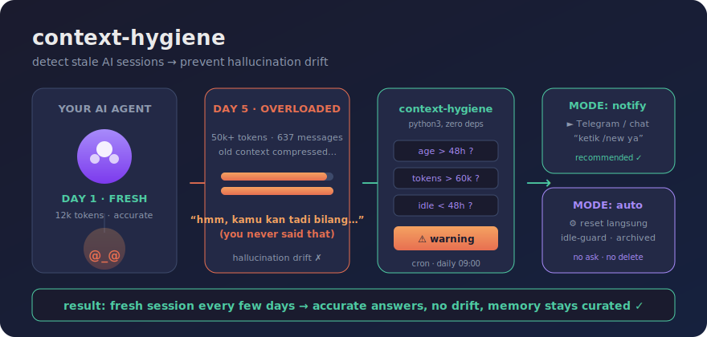

# context-hygiene 🧠🧹

<p align="center">
  
</p>

**Satu script Python (tanpa dependensi) yang mendeteksi sesi AI yang udah terlalu
lama / terlalu penuh — biar agent kamu gak halu karena "kepala penuh".**

Buat semua AI agent: **Hermes Agent, Claude Code, OpenCode, Codex CLI**, atau
tool lain yang nyimpen sesi sebagai file/SQLite.

> 📚 **Mau belajar / fork?** Baca [docs/ARCHITECTURE.md](docs/ARCHITECTURE.md) —
> panduan membaca kode file-per-file, pelajaran desain, dan daftar ide
> perbaikan buat kontributor. Kodenya sengaja kecil & bisa dibaca habis.

## Kenapa ini penting?

AI agent yang sesinya jalan berhari-hari pasti mengalami degradasi:

1. Konteks lama di-*compress* (diringkas mesin) biar muat
2. Ringkasan itu lossy → detail melenceng
3. Agent mulai "mengingat" hal yang sebenarnya tidak pernah dibicarakan = **halu**

Solusinya murah tapi harus rutin: **reset sesi secara teratur**, bawa cuma
ringkasan 3 kalimat, dan simpan fakta penting di memori permanen yang terkurasi.
Script ini ngasih tahu kamu **kapan** waktunya reset — berbasis data, bukan feeling.

## Cara kerja

```
$ python3 context_hygiene.py
context-hygiene: ⚠ sessions need attention:
  [hermes] 20261014_111932  age=95.6h tokens~66741 (age, tokens)
  → start a fresh session (/new or new chat) and carry over
    only a 3-sentence summary. Prevents hallucination drift.
$ echo $?
1
```

- Mendeteksi tool yang terpasang secara otomatis (`--tools auto`):
  - **Hermes Agent** → `~/.hermes/state.db` (gateway_routing + sesi CLI, termasuk profiles)
  - **Claude Code** → `~/.claude/projects/**/*.jsonl`
  - **Codex CLI** → `~/.codex/sessions/**/*.jsonl`
  - **OpenCode** → `~/.local/share/opencode/storage/**/*.json`
  - Dir bebas via `--extra-dir label=/path`
- Ngukur **umur sesi** dan **beban konteks** (token asli kalau tersedia,
  estimasi dari ukuran file kalau tidak)
- Exit code `1` kalau ada sesi yang butuh perhatian → gampang dipasang di cron

## Threshold default

| Sinyal | Default | Arti |
|---|---|---|
| Umur sesi | > 48 jam | Rantai kompresi makin panjang, drift numpuk |
| Prompt tokens | > 60.000 | Tekanan konteks → kompresi → recall rusak |
| Idle | > 48 jam | Sesi lama yang gak dipakai diabaikan (bukan warning) |

Ubah via flag:

```bash
python3 context_hygiene.py --max-age-hours 24 --max-prompt-tokens 40000
```

## Setup otomatis

**Cara termudah — installer interaktif:**

```bash
python3 install.py
```

Installer bakal nanya: tool mana yang dipakai, **mode reset** (notify/auto),
kirim notif ke mana (Telegram / chat session / webhook), threshold, dan jadwal
cron — lalu nulis wrapper + crontab sendiri. Aman dijalankan ulang kapan pun
buat ganti setting.

### Dua mode reset

| | `notify` (recommended) | `auto` |
|---|---|---|
| Perilaku | kirim peringatan → **kamu** ketik `/new` | reset langsung tanpa tanya |
| Notifikasi | Telegram / chat session / webhook (dipilih saat install) | tidak ada |
| Keamanan | — | idle-guard 15 menit (gak reset saat kamu lagi ngetik), sesi di-*archive* bukan dihapus |
| cocok buat | pengguna normal | server/headless yang gak dibaca manusia |

Contoh manual dua mode:

```bash
# deteksi dulu
python3 context_hygiene.py --json > warnings.json

# MODE 1: notifikasi ke Telegram (butuh TELEGRAM_BOT_TOKEN di env)
python3 reset_modes.py --mode notify --notify telegram:<chat_id> --warnings-file warnings.json

# MODE 1b: ke chat/session yang lagi dipakai (stdout)
python3 reset_modes.py --mode notify --notify session --warnings-file warnings.json

# MODE 2: reset otomatis (idle-guard + archive, tanpa pemberitahuan)
python3 reset_modes.py --mode auto --warnings-file warnings.json
```

### Hermes Agent (cron bawaan)

```bash
hermes cron create "0 9 * * *" \
  "Jalankan: python3 /path/ke/context_hygiene.py --json. \
   Kalau exit code 1, kirim notifikasi singkat (bahasa user) berisi sesi yang \
   kena warning + saran ketik /new. Kalau 0, jangan kirim apa-apa." \
  --name "context-hygiene" --deliver telegram:<chat_id>
```

Atau pasang **skill**-nya: copy `skill-hermes/` ke `~/.hermes/skills/context-hygiene/`.
Skill ini bikin agent paham *kenapa* dan *kapan* musti nyuruh kamu reset — dan
aturan emasnya: **agent gak boleh auto-reset, kamu yang ketik `/new`.**

### Linux/macOS cron biasa (buat Claude Code, Codex, dll)

```cron
# cek tiap jam 9 pagi, kirim output ke notifikasi/logs kamu
0 9 * * * /usr/bin/python3 /path/ke/context_hygiene.py >> ~/.context-hygiene.log 2>&1
```

Gabungkan dengan notifikasi apa pun (Telegram bot, ntfy, Slack webhook):

```bash
OUT=$(python3 context_hygiene.py) || curl -s "https://api.telegram.org/bot<TOKEN>/sendMessage" \
  -d chat_id=<ID> --data-urlencode "text=$OUT"
```

### n8n / workflow automation

Schedule trigger → Execute Command (`python3 context_hygiene.py --json`) →
IF exit code ≠ 0 → kirim pesan.

## Filosofi (versi singkat)

- **Sesi = memori kerja.** Sehat kalau muda dan ringan.
- **Memory file = catatan lama.** Fakta terkurasi saja, bukan transkrip.
- **Skill = prosedur.** Yang berulang, bukan yang sekali kejadian.
- Agent yang "inget semuanya" dalam 1 sesi panjang itu justru paling rentan halu.
  Agent yang sering reset + bawa catatan kecil yang presisi itu yang stabil.

## Requirements

- Python 3.9+ (stdlib only, zero pip install)
- Baca akses ke home directory tool yang mau dicek

## Struktur repo

```
context_hygiene.py      # deteksi & evaluasi sesi (semua tool)
reset_modes.py          # aksi: notify (Telegram/session/webhook) atau auto-reset
install.py              # wizard setup → wrapper + crontab otomatis
skill-hermes/SKILL.md   # skill buat agent Hermes (aturan perilaku)
docs/ARCHITECTURE.md    # 📚 panduan belajar kode + ide kontribusi
assets/banner.png|.svg  # ilustrasi
```

## Roadmap

- [ ] Backend untuk Cursor, Aider, Gemini CLI
- [ ] Mode `--notify telegram/ntfy` bawaan
- [ ] Estimasi token per-tool yang lebih akurat

## License

MIT — silakan fork, atas nama kepala AI yang sehat 🧠✨
